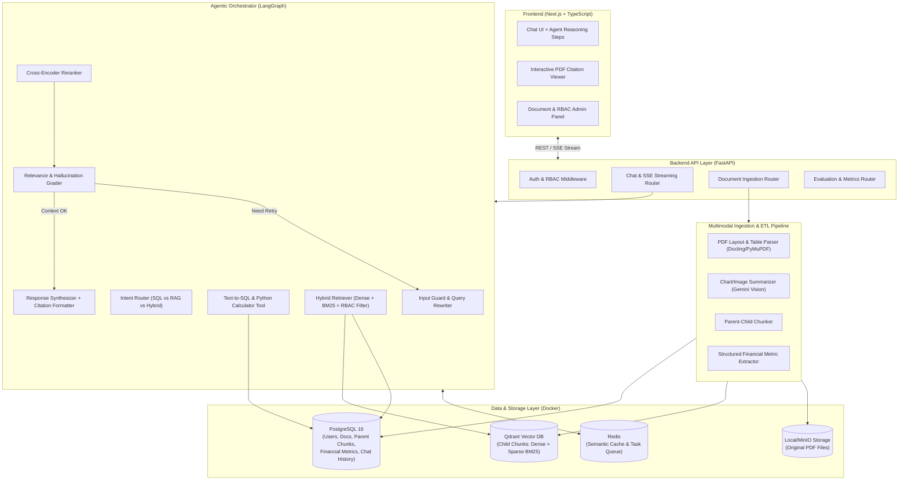
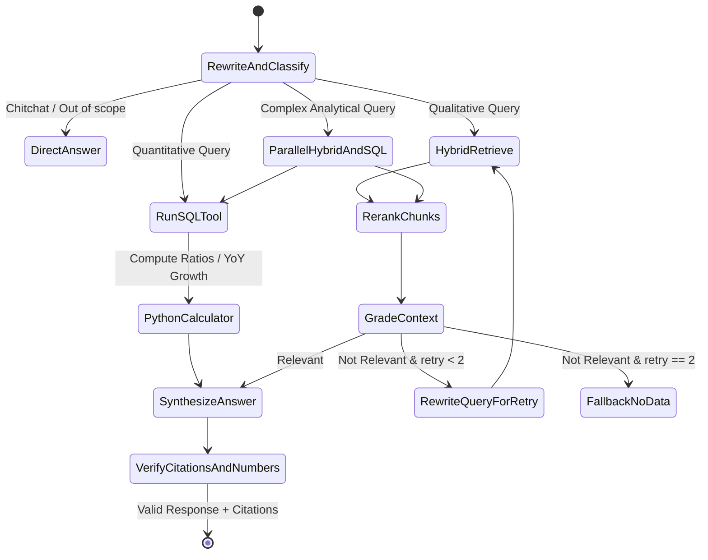

# Kiến trúc Hệ thống (System Architecture) — FinSight AI

Tài liệu này mô tả chi tiết kiến trúc kỹ thuật, cấu trúc thư mục, thiết kế cơ sở dữ liệu và luồng hoạt động của **FinSight AI**. Mọi module mới khi phát triển thêm cần đặt đúng vị trí đã quy hoạch trong tài liệu này.

---

## 1. Sơ đồ Kiến trúc Tổng thể (High-Level Architecture)



---

## 2. Luồng Hoạt động của Agentic Workflow (LangGraph State Machine)

Đây là phần "trái tim" của đồ án. Luồng Agent được quản lý bằng một `AgentState` tường minh:



### Cấu trúc `AgentState` (trong `app/agents/state.py`)
```python
from typing import TypedDict, Literal, Annotated
from pydantic import BaseModel

class CitationItem(BaseModel):
    doc_id: str
    doc_title: str
    ticker: str
    fiscal_year: int
    page_number: int
    snippet: str

class AgentState(TypedDict):
    user_query: str
    rewritten_query: str
    chat_history: list[dict]
    user_role: str
    target_tickers: list[str]
    target_years: list[int]
    intent: Literal["sql", "rag", "hybrid", "chitchat"]
    retrieved_chunks: list[dict]
    sql_results: list[dict]
    calculated_metrics: dict
    retry_count: int
    is_context_relevant: bool
    final_answer: str
    citations: list[CitationItem]
    reasoning_steps: list[str]
```

---

## 3. Thiết kế Cơ sở Dữ liệu (Database Schema)

### 3.1. PostgreSQL (Dữ liệu Quan hệ, RBAC & Bảng Chỉ số Tài chính)

1. **Bảng `users`**:
   - `id` (UUID, PK), `email`, `full_name`, `role` (`admin`, `analyst`, `viewer`), `created_at`.
2. **Bảng `documents`** (Quản lý file báo cáo gốc):
   - `id` (UUID, PK), `title`, `file_path`, `ticker` (VARCHAR, indexed, VD: `FPT`, `VNM`, `AAPL`), `company_name`, `fiscal_year` (INT, indexed), `period` (`FY`, `Q1`..`Q4`), `language` (`vi`, `en`), `access_level` (`public`, `internal_finance`, `executive_only`), `status` (`pending`, `processing`, `indexed`, `failed`), `total_pages` (INT), `created_at`.
3. **Bảng `parent_chunks`** (Lưu đoạn văn bản lớn hoặc toàn bộ bảng Markdown để cung cấp đủ ngữ cảnh cho LLM):
   - `id` (UUID, PK), `document_id` (FK -> `documents.id`), `page_number` (INT), `chunk_type` (`text`, `table`, `chart_summary`), `content_markdown` (TEXT), `section_title` (VARCHAR).
4. **Bảng `financial_metrics`** (Dữ liệu có cấu trúc phục vụ Text-to-SQL & tính toán chính xác):
   - `id` (UUID, PK), `document_id` (FK -> `documents.id`), `ticker` (VARCHAR, indexed), `fiscal_year` (INT, indexed), `period` (VARCHAR), `statement_type` (`income_statement`, `balance_sheet`, `cash_flow`, `ratios`), `metric_code` (VARCHAR, chuẩn hóa: `REVENUE`, `GROSS_PROFIT`, `NET_INCOME`, `TOTAL_ASSETS`, `TOTAL_EQUITY`, `ROE`, `ROA`, `EPS`...), `metric_name_vi` (VARCHAR), `metric_name_en` (VARCHAR), `value` (NUMERIC(20, 4)), `unit` (`VND_BILLION`, `USD_MILLION`, `PERCENT`), `source_page` (INT).
5. **Bảng `chat_sessions` & `chat_messages`**:
   - Lưu lịch sử hội thoại, `citations` (JSONB), `reasoning_steps` (JSONB), `latency_ms` (INT) và `token_usage` (JSONB).

### 3.2. Qdrant Vector Database (Collection: `finsight_child_chunks`)
Mỗi Point trong Qdrant đại diện cho một **Child Chunk** (đoạn nhỏ ~300 tokens hoặc tóm tắt của 1 bảng) liên kết về `parent_chunk_id` trong PostgreSQL:
- **Vectors:**
  - `dense`: Vector ngữ nghĩa (từ Gemini Embedding `gemini-embedding-001` hoặc `BAAI/bge-m3`).
  - `sparse`: Vector từ khóa BM25 (phục vụ bắt chính xác mã chỉ tiêu, năm, tên riêng).
- **Payload (Indexed để lọc nhanh trước khi tìm kiếm):**
  ```json
  {
    "document_id": "uuid",
    "parent_chunk_id": "uuid",
    "doc_title": "Báo cáo thường niên FPT 2024",
    "ticker": "FPT",
    "fiscal_year": 2024,
    "period": "FY",
    "access_level": "public",
    "page_number": 45,
    "chunk_type": "table",
    "section_title": "Kết quả kinh doanh khối Công nghệ",
    "text": "Nội dung child chunk..."
  }
  ```

---

## 4. Cấu trúc Thư mục Dự án (Project Directory Structure)

Cấu trúc được thiết kế theo hướng **Clean & Modular Architecture** để bạn dễ dàng thêm tính năng mới mà không làm phình các file cũ:

```text
d:\Đồ án CNTT\
├── README.md                        # Tổng quan dự án & hướng dẫn nhanh
├── AGENTS.md                        # Quy tắc dành cho AI khi viết code
├── docker-compose.yml               # Khởi chạy Postgres, Qdrant, Redis, Langfuse
├── .env.example                     # Mẫu cấu hình biến môi trường
├── docs/                            # Tài liệu thiết kế & nghiên cứu
│   ├── SPEC.md                      # Đặc tả yêu cầu nghiệp vụ
│   ├── ARCHITECTURE.md              # Kiến trúc kỹ thuật & Database Schema
│   ├── TASKS.md                     # Lộ trình triển khai & Prompt mẫu
│   └── THESIS_NOTES.md              # Ghi chú lý thuyết & kết quả thực nghiệm cho báo cáo đồ án
│
├── data/                            # Dữ liệu mẫu & bộ kiểm thử
│   ├── raw_pdfs/                    # File PDF báo cáo tài chính gốc
│   ├── processed_md/                # Kết quả bóc tách Markdown (để kiểm tra chất lượng parse)
│   └── eval_datasets/               # Bộ câu hỏi chuẩn (Golden Q&A Dataset JSON/CSV)
│
├── backend/                         # Python FastAPI + LangGraph Backend
│   ├── pyproject.toml               # Khai báo thư viện Python
│   ├── alembic/                     # Quản lý Database Migrations
│   ├── app/
│   │   ├── main.py                  # Điểm khởi chạy FastAPI app
│   │   ├── core/                    # Cấu hình chung (config, security, logging, exceptions)
│   │   ├── db/                      # Kết nối PostgreSQL, Qdrant client, Redis client
│   │   ├── models/                  # SQLAlchemy ORM models (users, documents, financial_metrics...)
│   │   ├── schemas/                 # Pydantic Request/Response schemas
│   │   ├── api/                     # Các HTTP Endpoints (v1/chat, v1/documents, v1/eval)
│   │   ├── services/                # Business Logic độc lập
│   │   │   ├── ingestion/           # PDF Parser, Table Extractor, Parent-Child Chunker, Financial ETL
│   │   │   ├── retrieval/           # Hybrid Search (Dense+BM25), Reranker, RBAC Filter
│   │   │   └── cache/               # Semantic / Exact Query Cache với Redis
│   │   ├── agents/                  # Hệ thống Agentic RAG (LangGraph)
│   │   │   ├── state.py             # Định nghĩa AgentState
│   │   │   ├── graph.py             # Lắp ráp các Node thành StateGraph
│   │   │   ├── nodes/               # Từng bước xử lý: router, retriever, sql_agent, grader, synthesizer
│   │   │   ├── tools/               # Công cụ: sql_query_tool, financial_calculator_tool
│   │   │   └── prompts/             # Toàn bộ System Prompts tách riêng theo từng nhiệm vụ
│   │   └── llm/                     # Lớp Adapter gọi LLM & Embedding (Gemini, OpenAI, Local)
│   ├── evaluation/                  # Pipeline chạy thực nghiệm & chấm điểm RAGAS
│   │   ├── run_benchmark.py         # Chạy so sánh Naive RAG vs Hybrid RAG vs Agentic RAG
│   │   └── metrics_report.py        # Xuất bảng kết quả và biểu đồ cho báo cáo tốt nghiệp
│   └── tests/                       # Bộ kiểm thử tự động (pytest)
│       ├── unit/
│       └── integration/
│
└── frontend/                        # Giao diện Web (Next.js App Router + Tailwind + shadcn/ui)
    ├── package.json
    └── src/
        ├── app/                     # Các trang chính (Chat Workspace, Documents Admin, Eval Dashboard)
        ├── components/
        │   ├── chat/                # Khung chat, hiển thị bước suy luận Agent, bảng số liệu
        │   ├── pdf-viewer/          # Khung đọc PDF tự cuộn tới trang trích dẫn (Citation Viewer)
        │   └── documents/           # Upload PDF, xem trạng thái ETL & chuyển đổi Role demo
        └── lib/                     # API client, SSE stream parser, state management
```

---

## 5. Thiết kế các Điểm Mở rộng (Extension Points)

Để sau này bạn phát triển thêm tính năng mà **không phải đập đi xây lại**, hệ thống áp dụng 3 nguyên tắc mở rộng:

1. **Thêm Công cụ mới cho Agent (New Agent Tools):**
   - Chỉ cần tạo 1 file mới trong `backend/app/agents/tools/` (ví dụ `stock_price_tool.py`), đăng ký vào danh sách tools của `Router_Node` mà không ảnh hưởng tới luồng RAG hay PDF Ingestion.
2. **Đổi hoặc Kết hợp nhiều Mô hình LLM / Embedding:**
   - Mọi lệnh gọi LLM đều đi qua interface `LLMProvider` trong `backend/app/llm/`. Bạn có thể dùng Gemini Flash cho bước phân loại/kiểm tra (nhanh, rẻ) và Gemini Pro cho bước tổng hợp phân tích tài chính sâu chỉ bằng cách đổi cấu hình trong `.env`.
3. **Thêm Loại Tài liệu mới (DOCX, Excel, HTML):**
   - Trong `backend/app/services/ingestion/`, các bộ đọc tài liệu tuân theo giao diện chung `BaseDocumentParser` trả về cùng một cấu trúc `ParsedDocument` (danh sách trang, bảng, đoạn văn). Chunker và Vector Indexer phía sau giữ nguyên 100%.
